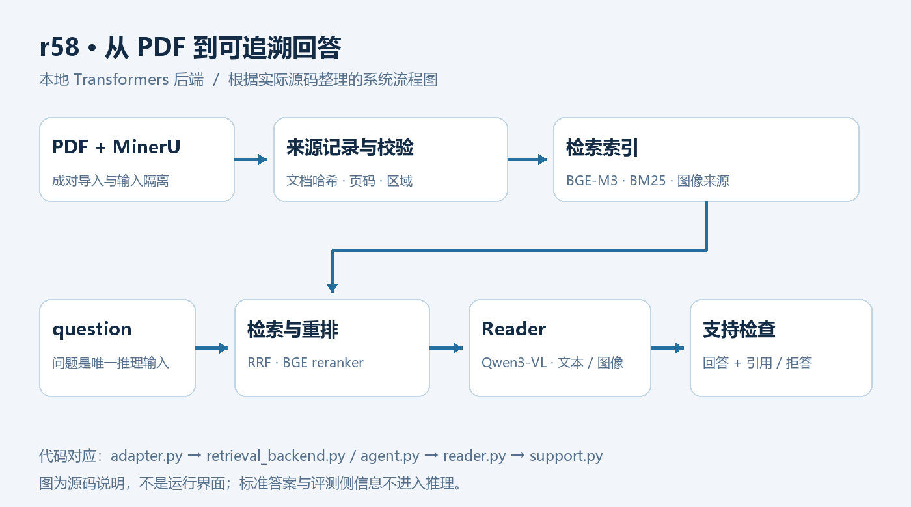
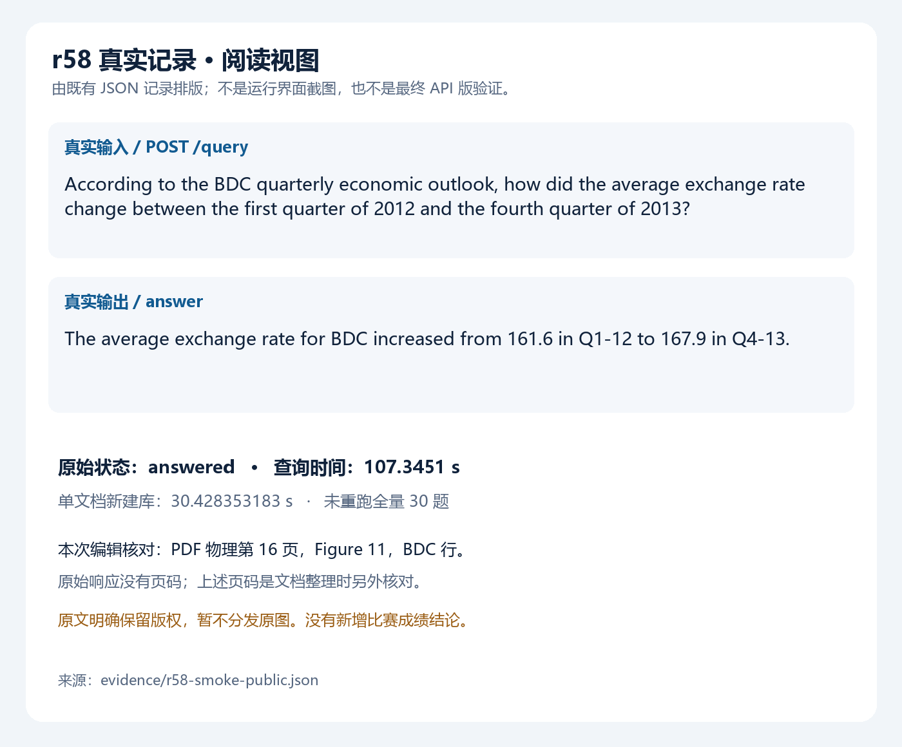
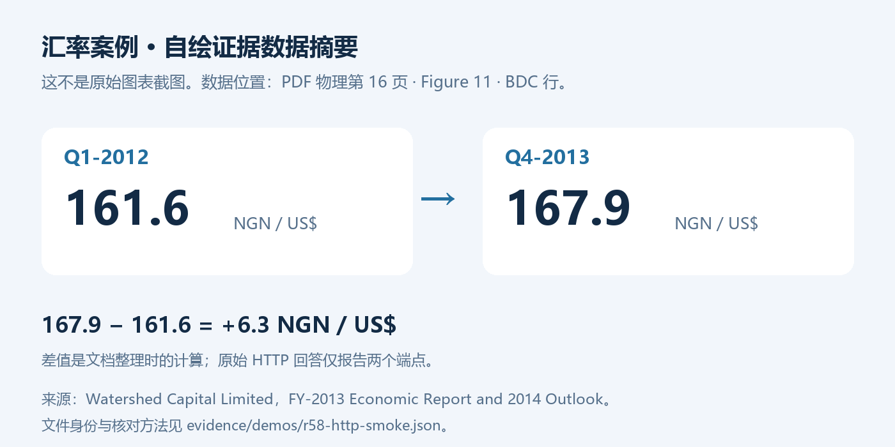
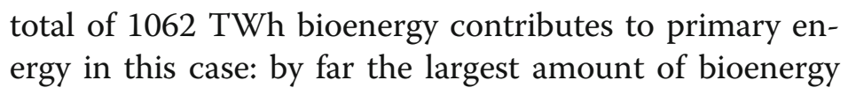

# 不二鸟 · 华为存储杯多模态检索问答

从 PDF 的文本、表格和图像中检索证据，给出可追溯回答，并通过支持检查处理拒答。项目基于已提交的 **`最终发布准备_20261015_r58`** 版本，使用 **本地 Transformers + Qwen3-VL-8B-Instruct、BGE-M3、BGE reranker**。



源码来自 r58 官网正式 ZIP，与配套全量包的 **1,909 个共同非清单文件逐字节一致**；两个包的 CRC、官网 1,909 项及全量 3,929 项清单哈希核对通过。[源码版本与来源](docs/SOURCE_AND_SCOPE.md)。

## 看一次真实输入与输出

下面展示 2026-10-15 的 r58 单文档新建库与 HTTP 查询，图片将原始 JSON 中的问题、回答和耗时整理为阅读视图。



```json
{"question":"According to the BDC quarterly economic outlook, how did the average exchange rate change between the first quarter of 2012 and the fourth quarter of 2013?"}
```

真实返回的 `answer`：

> The average exchange rate for BDC increased from 161.6 in Q1-12 to 167.9 in Q4-13.



回答所用数值经原文核对，位于 **PDF 物理第 16 页、Figure 11、BDC 行**。文档为 Watershed Capital Limited 发布的 *FY-2013 Economic Report and 2014 Outlook*，上图按原文数据绘制。原始问题、回答、图片编号和记录哈希见[精选查询案例](evidence/demos/r58-http-smoke.json)。

## 更多真实案例

以下两例选自 r58 本地评测，分别展示正文取值与图像问题的拒答处理。来源编号用于查阅对应文档。

| 场景 | 实际问题 | 实际最终输出 | 来源定位 |
|---|---|---|---|
| 能源正文取值 | How much energy from biomass is anticipated to be supplied to the UK's total primary energy under the DECC scenario referred to as SBF, when measured in terawatt-hours? | `1062` | `energy_2357218`，物理第 13 页 |
| 图像问题拒答 | Which machinery is usually employed to clear snow on River Street during December 2008 as depicted? | 空字符串 `""` | 审阅对应文档：`construction_1676343` 第 12 页 |

能源案例对应原文片段：



来源：Patrick E. Allen、Geoffrey P. Hammond，*Bioenergy utilization for a low carbon future in the UK: the evaluation of some alternative scenarios and projections*，BMC Energy 1, 3 (2019)。[论文与 DOI](https://doi.org/10.1186/s42500-019-0002-9)，[CC BY 4.0](https://creativecommons.org/licenses/by/4.0/)。上图为 PDF 物理第 13 页的正文裁片。[图像归属记录](evidence/demos/energy-image-attribution.json)与[案例原值及哈希](evidence/demos/r58-selected-cases.json)。

## 评测结果

| 评测 | 结果 | 方法 |
|---|---|---|
| r58 发布接口 30 题本地评测 | **26/30（86.67%）** | 同模型判分 |
| 同作者原文完整支持审阅 | **25/30（83.33%）** | 逐题核对回答的原文支持 |
| 2026-10-15 单文档 HTTP 测试 | 建库 **30.428353183 s**，查询 **107.3451 s** | 新建库与 question-only HTTP 查询 |

提交包包含 **385 项测试**，此前版本保留 381 项测试记录。推理后端采用本地 Transformers，`*_vllm.py` 为赛事兼容入口。详见[系统设计](docs/DESIGN.md)、[版本记录](docs/HISTORY.md)与[软件检查和源码核对](evidence/publication-r58-20261016-validation.json)。

## 运行

准备有权使用的成对 PDF / MinerU 解析文件、固定模型资源和匹配的 Python 3.12 GPU 环境。然后从仓库根目录运行：

```sh
cp .env.example .env
# 编辑 .env，填写本机模型和输入路径；不要把真实凭据提交到 Git。
export MRAG_PYTHON=/path/to/qualified-environment/bin/python
"$MRAG_PYTHON" -I -B scripts/verify_release_runtime.py --role client
"$MRAG_PYTHON" -I -B scripts/verify_release_runtime.py --role worker
DOTENV_FILE="$PWD/.env" bash rag-anything-experiments/run.sh run_rag_build
DOTENV_FILE="$PWD/.env" bash rag-anything-experiments/run.sh run_rag_server
```

构建目录必须是新的不存在目录，真实构建完成后再启动查询。模型、完整环境和索引不在 Git 中；模型身份、平台依赖、数据获取与复现限制见[运行说明](docs/RUNNING.md)和[模型资源](docs/MODELS.md)。

```sh
curl --fail --header 'Content-Type: application/json' \
  --data '{"question":"What does the supplied document say about its main subject?"}' \
  http://127.0.0.1:8080/query
```

查询接口接收 `question` 字段；标准答案与评分由评测流程管理。

## 源码导航

| 目录 | 内容 |
|---|---|
| [src/evidence_lab](src/evidence_lab) | 完整应用核心：检索、证据绑定、Reader、支持检查与恢复 |
| [rag-anything-experiments](rag-anything-experiments) | r58 构建、HTTP 服务、原 benchmark / judge / score 接口与依赖加载器 |
| [scripts](scripts)、[tests](tests) | 构建工具、运行预检和合成软件测试 |
| [configs](configs)、[environment](environment) | 冻结算法配置、依赖和模型身份契约 |
| [docs/DESIGN.md](docs/DESIGN.md) | 检索、Reader、来源绑定与支持检查的系统设计 |
| [raganything](raganything)、[reference](reference) | 原始库与官方参考入口，附第三方许可 |

仓库提供应用源码、运行配置、测试与精选演示。第三方归属见 [THIRD_PARTY.md](THIRD_PARTY.md)。
